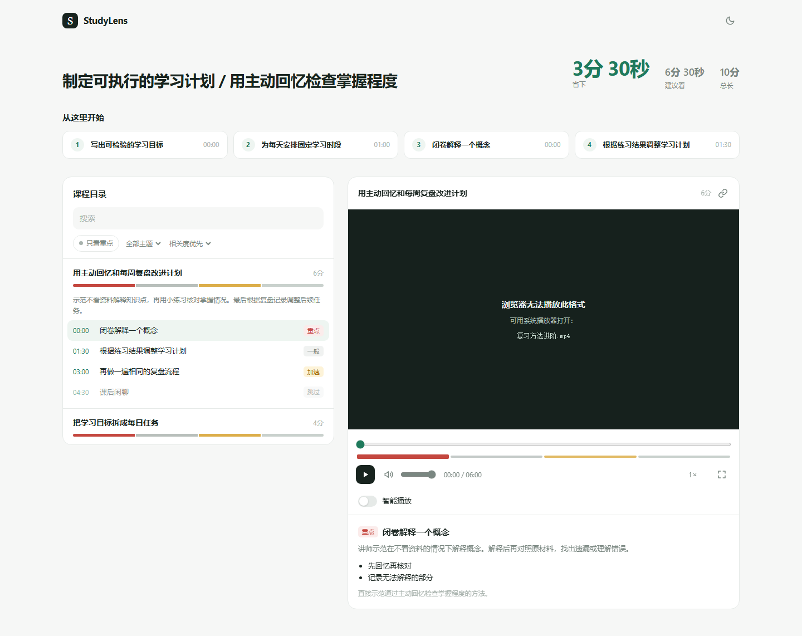
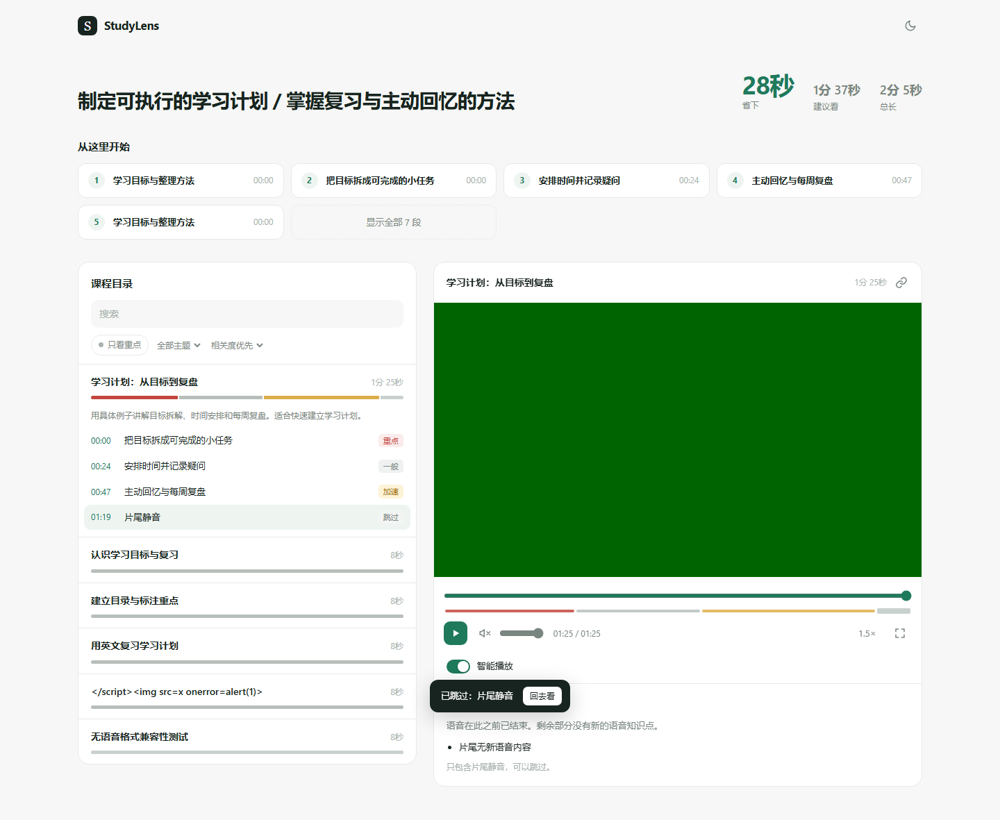
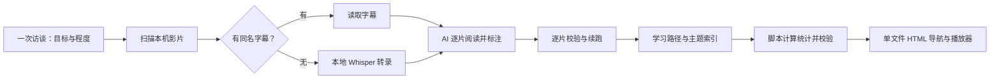

# StudyLens

[](https://github.com/boxuanzou468-blip/studylens/actions/workflows/ci.yml)

Python 3.12 单元测试及 ffmpeg 字幕流水线已通过 Windows、macOS、Linux 的 GitHub Actions 验证。[查看三平台运行记录](https://github.com/boxuanzou468-blip/studylens/actions/runs/39732402291)。

把一堆本机学习影片，变成按你的目标排序、能直接跳到重点的离线学习导航。




> 这是 **AI agent skill + 本地脚本**，不是独立聊天机器人或在线视频网站。Claude Code / Codex 负责理解内容；脚本负责转录、校验、统计和生成报告。你无需为 StudyLens 配置 LLM API key，但需要自己可用的 AI agent。

## 怎么工作



四种标签均有文字和颜色：**重点**、**一般**、**加速**、**跳过**。每段含标题、摘要、知识点和针对学习目标的理由。智能播放按标签加速或跳过；你主动拖到跳过段时会保留观看选择，并可在跳过提示上点「回去看」。

## 准备环境

- Python ≥3.10、ffmpeg/ffprobe；AI 可检查并在宿主权限允许时安装缺失依赖。
- 完整仓库目录：`SKILL.md`、`scripts/`、`schema/`、`templates/`、`requirements.txt` 缺一不可。
- 本机影片目录，可包含中文、空格等字符。已有完整同名 `.srt/.vtt/.ass` 会优先使用。
- 第一次由 AI 在 StudyLens 所在目录建立 `.venv` 并安装依赖。Whisper 默认 small，本机运行；首次模型下载需要网络/磁盘空间。没有 GPU 也可运行，速度取决于机器与影片时长。

手动检查（先进入仓库目录）：

```powershell
# Windows；python 不在 PATH 时可用 py -3 或已安装解释器的绝对路径
py -3 -m venv .venv
& .\.venv\Scripts\python.exe -m pip install -r requirements.txt
& .\.venv\Scripts\python.exe scripts\check_env.py
```

```bash
# macOS / Linux
python3 -m venv .venv
.venv/bin/python -m pip install -r requirements.txt
.venv/bin/python scripts/check_env.py
```

## 在 Claude Code 中使用

最简单：下载整个仓库，在 Claude Code 中提供 `SKILL.md` 的绝对路径，再发送下面的使用请求。AI 按本说明书执行，不需要先读开发批次文档。

若希望作为 `/studylens` 使用，将整个 StudyLens 放到用户目录 `~/.claude/skills/studylens/`，或项目目录 `.claude/skills/studylens/`。不要仅复制 SKILL.md，不要搬运旧路径下已生成的 .venv；在新位置重建。位置与调用方式见 [Claude Code 官方技能文档](https://code.claude.com/docs/en/skills#where-skills-live)。

## 在 Codex 中使用

无需安装也可直接提供 `SKILL.md` 绝对路径。可安装到用户目录 `~/.agents/skills/studylens/`，或仓库目录 `.agents/skills/studylens/`，然后显式使用 `$studylens`。这里采用当前 [OpenAI 官方目录说明](https://learn.chatgpt.com/docs/build-skills#where-codex-loads-local-skills)，核对日期为 2026-10-21；不要把已有环境的旧缓存位置当成当前推荐位置。

放入整个干净仓库副本（不要复制 .venv、.studylens、个人影片）。官方也支持链接技能目录；如果不希望移动现有仓库，macOS/Linux 可以：

```bash
mkdir -p ~/.agents/skills
ln -s /你的绝对路径/studylens ~/.agents/skills/studylens
```

Windows 可在空闲的技能名称路径创建目录链接，或直接使用 SKILL.md 的绝对路径；已有同名目录时先自行选择要用哪一份，不覆盖已有技能。技能未出现时重启 Codex。

## 一句话开始

```text
用 StudyLens 帮我整理 D:\课程 这个文件夹，我想学用 Python 自动整理 Excel，目前有编程基础，时间预算 40 分钟，输出简体中文。
```

尚未安装时，在前面加：

```text
请完整读取 D:\工具\studylens\SKILL.md，然后执行上述任务。
```

AI 会一次询问尚缺的目标、程度、目录及可选预算/语言；已有结果时会确认沿用还是重新分析。目标太泛会再澄清一次。完成后打开 `影片目录/studylens-report.html`，你会拿到总时长、建议观看时长、节省时间和最该先看的片段。

## 输出、恢复与目标更新

```text
你的影片目录/
├── 课程.mp4
├── 课程.srt                 可选
├── studylens-report.html    打开这份报告
└── .studylens/
    ├── profile.json
    ├── manifest.json
    ├── transcripts/
    ├── analysis/
    └── library.json
```

转录和分析按影片保存。中断后再次提出相同请求，已通过校验且目标未变的分析会跳过；无需整批重新转录。更改转录参数默认仍复用已有结果，确实需要重做识别时才用 `--force`。

profile 修改时间比 analysis 新时，校验器和报告构建会警告「学习目标可能已更新」。这是保守的文件时间检查，并不表示脚本理解了目标差异；仅改语言或预算也可能触发。沿用结果时不应无故重写 profile。按新目标重新标注时，由 AI 重新分析，原转录通常继续复用。

统计由 `library_stats.py` 计算：

```powershell
& .\.venv\Scripts\python.exe scripts\library_stats.py 'D:\课程'
& .\.venv\Scripts\python.exe scripts\validate.py 'D:\课程\.studylens\library.json'
& .\.venv\Scripts\python.exe scripts\build_report.py 'D:\课程'
```

`recommended_sec` 是整库按标签播放的建议时长；预算约束的是 AI 另外挑出的学习路径，两者不一定相同。链接锚点 `#v=<video_id>&t=<秒>` 可定位笔记，但本机文件链接不是公共托管地址。移动或分享时保留报告与视频的相对目录结构，接收者可能需要在自己的报告路径下使用该锚点。

## 隐私与网络边界

影片和逐字稿文件保存在本机；脚本不调用 LLM API，也不自动上传视频。**分析由你自己的 AI agent 完成，agent 读取的逐字稿内容可能发送给你选择的模型服务**，具体取决于该 agent 的配置与服务政策，不能把它误认为模型分析也全部离线。

依赖安装和初次 Whisper 模型下载会访问包/模型站点；已有字幕或本地模型可跳过相应下载。报告不依赖 CDN、外部字体或在线服务。Hugging Face 连接失败时，可使用完整本地模型目录，或由你手动选择 `HF_ENDPOINT=https://hf-mirror.com`；它是第三方镜像，不会自动启用。不要把 API key、登录信息或个人身份资料写进本项目。

## 已知限制与验收边界

- 第一版只处理本机文件，不处理 YouTube/B 站网址，没有桌面 GUI。
- 只识别完整同名字幕；`课程.zh.srt` 等语言后缀和 MKV 内嵌字幕轨暂不支持。编码按 UTF-8→带 BOM UTF-16→GB18030 尝试，有歧义时显式指定 `--subtitle-encoding`。
- Whisper 可能有同音错字、漏标点或错误语音；没有可用文本时整片标 skip 并注明无法判断，不靠片名猜画面。自然课程、噪音、多人/多语种与超长课程准确率尚不能由测试素材证明。
- Chromium 不能播放某些容器/编码时会提示路径，可改用系统播放器按时间观看；目前不自动转码。单个封装格式并不保证一定能播或不能播。
- 输入指纹使用大小和 mtime；人为保留相同大小/时间的改动不能可靠检测。不要同时开多个进程写同一个素材目录。中断中的那一支转录仍需从头做，已完成影片保留。
- schema 只验证结构、时间与引用，不能保证摘要正确或标签适合用户。过长/过短段落及过期分析给出警告；错误会阻止生成报告，警告不会擅自改写内容。
- 使用不支持 Range 请求的 HTTP 预览服务器时，视频可能无法定位。请直接双击 HTML 文件，在本地浏览器打开，或使用支持 Range 的服务。
- GPU 需要兼容运行库，auto 可回退 CPU；本机验收未证明 GPU 成功推理，也不自动安装 CUDA/驱动。
- Python 3.12 单元测试与 ffmpeg 字幕流水线已在 Windows、macOS、Linux CI 通过；本地文件播放、离线交互和模拟手机宽度的浏览器验收在 Windows Chromium 完成。macOS/Linux 浏览器、实际手机与 Safari/Firefox 尚未验证。剪贴板、自动播放和 localStorage 受浏览器策略约束，有手动播放/复制及不持久化的退路。
- Claude Code 与 Codex 的独立完整流程验收状态见最新交接记录；脚本/浏览器检查通过不代替两边 agent 都能独立执行的证据。

运行开发检查：项目 venv Python 执行 `-m unittest discover -s tests -v`。测试分层、ffmpeg、Playwright/Chromium 和可选本地模型的准备见 [tests/README.md](tests/README.md)。CI 尚未实际运行的平台不会列为已验证。

## 授权

[MIT](LICENSE) · Copyright (c) 2026 StudyLens contributors。第三方模型、依赖和用户视频遵循各自的授权。

---

## English

StudyLens turns a folder of local learning videos into a personalized, clickable study guide. It is a **skill for your own AI agent plus local Python scripts**, not a hosted video service. See the screenshots above for the catalog, timeline labels, player, and automatic skip notice with an undo action.

### Workflow

Interview → scan local files → use matching subtitles or local Whisper → analyze one video at a time → validate each analysis → organize a learning path and topics → calculate statistics with a script → generate one offline HTML report.

Labels are **must, normal, speed, skip**, each with visible text and a reason tied to your goals. Smart playback respects a manual seek into a skipped section and restores your preferred base rate after an accelerated section.

### Install and run

Keep the whole repository together. Python 3.10+, ffmpeg/ffprobe, and a usable Claude Code or Codex agent are required. The agent creates `.venv` in the skill folder and installs `requirements.txt`; scripts make no LLM API calls and need no project-specific API key. Whisper defaults to `small`, using available CUDA or falling back to CPU.

- **Claude Code:** place the full folder at `~/.claude/skills/studylens/` or `.claude/skills/studylens/`, then invoke `/studylens`, or directly provide the absolute `SKILL.md` path. See [official Claude Code guidance](https://code.claude.com/docs/en/skills).
- **Codex:** use `~/.agents/skills/studylens/` or repo-local `.agents/skills/studylens/`, then invoke `$studylens`, or provide the absolute `SKILL.md` path. See [current OpenAI guidance](https://learn.chatgpt.com/docs/build-skills#where-codex-loads-local-skills). Copy the complete source folder, not an existing virtual environment.

```text
Use StudyLens to organize D:\Courses. I want to automate Excel files with Python, have basic programming experience, and have a 40-minute budget. Write the report in English.
```

Missing interview fields are asked together. Existing results prompt a reuse-versus-reanalysis choice. Valid completed analyses resume without rereading every transcript. Changed goals may require new labels, while existing transcripts usually remain reusable.

### Data and privacy

Outputs live in `<video-folder>/.studylens/`; open `<video-folder>/studylens-report.html`. `library_stats.py` supplies deterministic timing JSON, and `build_report.py` validates inputs before writing. Whole-library recommended time and the budgeted learning-path time are different quantities.

Video and transcript files stay local, and the HTML has no CDN dependencies. Your AI agent may send text it reads to its configured model provider: **local files do not imply fully offline AI analysis**. Dependency/model downloads require network access unless already cached. A local model path can be used without downloading; an optional third-party Hugging Face mirror is never enabled automatically.

### Limits

Local videos only; no online URL ingestion, GUI, automatic transcoding, language-suffixed sidecars, or embedded subtitles. ASR can be wrong and does not establish visual content. Missing text produces a whole-video skip record. Some codecs require a system player. File links are local, not hosted sharing links. File fingerprints use size/mtime, and simultaneous writers to one media folder are unsupported.

Warnings flag unusual segmentation or a profile newer than its analysis. Semantic quality still depends on the agent and source material. HTTP preview servers without Range support may prevent seeking; open the HTML directly in a local browser. Python 3.12 unit tests and the ffmpeg subtitle pipeline pass on Windows, macOS and Linux in GitHub Actions. Browser/file playback and simulated mobile widths have been exercised on Windows Chromium; macOS/Linux browsers, other browser engines and actual phones remain separate validation work. See the latest handoff record for independent Codex/Claude Code end-to-end acceptance status.

Licensed under [MIT](LICENSE), © 2026 StudyLens contributors. Third-party models, dependencies and source videos retain their own licenses.


[开发记录](docs/dev/README.md)

